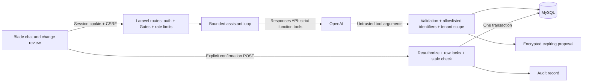

# Another · AI database assistant

An installable Laravel 13 package for an existing authenticated application. Includes a responsive Blade chat UI, OpenAI Responses and Google Gemini integrations, schema discovery, tenant-scoped paginated reads and counts, and preview/confirm create, update, and delete operations.

The supplied workspace had no application code or schema. `projects` is an explicit sample domain, not a claim about your application. This package must be wired into the host's authentication, authorization, schema and business rules before deployment. It is not a standalone Laravel application or a general SQL administration console.

## Architecture



Application code, not the model, decides scope and permissions. Tenant IDs come only from the authenticated user. The model receives no credentials and has no SQL execution or confirmation tool. Every database value goes through Query Builder binding. Resource identifiers come from server configuration. Results are limited to 50 rows and strings to 1,000 characters. Fixed MySQL SELECT execution hints cap reads at 1,500 ms; tool output is capped at 40 KB.

Writes are encrypted proposals bound to an actor and tenant, expiring after ten minutes. Confirmation locks the proposal and target row, checks current authorization, validates fields again, rejects stale snapshots, then changes the row and records an audit event in the same connection/transaction. Replaying a completed confirmation does not repeat the mutation. All involved tables must use InnoDB on the same primary database.

## Install into Laravel 13

Requirements: PHP 8.3+, Composer, Laravel 13, MySQL 8.4, authenticated sessions, and an OpenAI API key. Use a server-side session driver and an atomic-lock-capable cache such as Redis. Do not use cookie sessions: chat requests use session blocking to serialize history updates.

Add a path repository in your host application's `composer.json`, replacing the sample path:

```json
{
  "repositories": [{"type": "path", "url": "../database-assistant"}],
  "require": {"another/database-assistant": "@dev"}
}
```

Merge this with existing Composer settings, then run in the host:

```sh
composer update another/database-assistant
php artisan vendor:publish --tag=assistant-config
php artisan migrate
```

Configure environment variables (never commit actual secrets):

```dotenv
OPENAI_API_KEY=
OPENAI_MODEL=gpt-5.4-mini
ASSISTANT_PROVIDER=gemini
GEMINI_API_KEY=
GEMINI_MODEL=gemini-3.1-flash-lite
ASSISTANT_DB_CONNECTION=mysql
SESSION_DRIVER=redis
CACHE_STORE=redis
SESSION_SECURE_COOKIE=true
APP_DEBUG=false
```

The model is configurable; verify access in your OpenAI project. No live API call is needed for tests. Set reverse-proxy and PHP request timeouts above 120 seconds, since a turn allows up to four 25-second model requests. For larger workloads, move orchestration to a queued job and deliver progress with SSE/polling rather than extending synchronous request budgets.

Choose `ASSISTANT_PROVIDER=gemini` or `openai`. Gemini uses Google's native `generateContent` endpoint and the same validated database tools and confirmation workflow. The locally supplied keys are stored only in ignored `.env`; copy the selected provider's configuration into the host Laravel application's environment and refresh its config cache. There is no automatic provider fallback. Conversation history is separated by provider, and the UI identifies the selected data recipient. Google receives permitted prompts/results when Gemini is selected; OpenAI-specific retention settings do not apply to Google. Review your Google project's data terms before enabling business data.

To run billable live tests, start the isolated test database, set the test database environment variables described in [test results](docs/TEST-RESULTS.md), and execute `php scripts/test-live.php`. The runner selects the provider from `.env`. Ordinary tests use fake HTTP responses and skip both live cases.

Define these Gates in the host `AppServiceProvider::boot`. The role names below are illustrative; adapt to your own membership and authorization model. Undefined Gates deny access.

```php
Gate::define('assistant.access', fn ($user) =>
    $user->tenant_id !== null && $user->can_use_database_assistant);

Gate::define('assistant.read', fn ($user, string $resource) =>
    $resource === 'projects' && $user->can_view_projects);

Gate::define('assistant.write', fn ($user, string $resource) =>
    $resource === 'projects' && $user->can_manage_projects);
```

Ensure these checks validate active membership, not just a client-selected workspace. The `tenant_id` must come from a trusted server-side identity/membership resolution. Clear assistant session history when roles or permissions change. The history key already separates users and tenants.

The example table requires `id` (auto-increment primary key), `tenant_id`, `name` (varchar 120), and `status` (`planned`, `active`, `completed`), with a composite `(tenant_id, id)` index. This package deliberately does not create or migrate business tables. Add resources in `config/assistant.php`; each must have an `id`, `tenant_id`, safe output `columns`, and Laravel validation `rules` for writable fields. Never allow credentials, financial secrets, `tenant_id`, or IDs as writable fields. Keep allowed text fields short and non-sensitive.

Visit `/assistant` while signed in. The route names are `assistant.index`, `assistant.chat`, `assistant.reset`, and `assistant.confirm`.

## Adapting to real business operations

The included generic adapter uses Query Builder and **does not execute Eloquent observers, model policies, soft deletes, casts, or domain lifecycle hooks**. Before enabling writes on real tables, replace the `DatabaseTools::confirm` mutation branches with your application services and their row-level policies. Preserve the transaction, lock, ownership, expiry and idempotency checks. Use a version column if other writers can make ABA changes (change a value and restore it before confirmation).

Only use the generic delete path on records without cascading effects. For cascades, billing actions, notifications, unique constraints, required timestamps, related records, or restricted state transitions, implement a named domain operation that previews the full impact and validates those invariants. Do not expose unrestricted joins, arbitrary SQL, DDL, grants, backups or restore operations through the chat. A full database assistant can explain and propose those administrative tasks, but their execution belongs in separately authorized operational workflows.

The current tools support schema discovery, ID-filtered/cursor-paginated records, counts, and one-record CRUD. Add task-specific filtering/aggregation tools for application reports; add asynchronous export jobs if needed. Arbitrary analytics, SQL optimization, migrations and backup automation are not implemented.

## Security and operations

- Use HTTPS, CSRF and the existing login flow. Do not put the API key in JavaScript. The UI renders model text using `textContent`, not HTML or Markdown.
- The MySQL account should have only SELECT and the required per-table INSERT/UPDATE/DELETE permissions. No DDL, FILE, PROCESS, administrative grants or access to unrelated tables. Migrations should use a separate deploy credential. The implementation uses one connection for atomic writes and audit records; it is not an independently isolated read-only database account.
- OpenAI receives the prompt, bounded recent conversation text, and permitted tool results. `store: false` disables Responses application-state storage; it is not a promise of zero provider retention. Assess organization data controls before sending personal data. Exclude sensitive fields at the allowlist, not in prompts.
- Conversation text is held in the host's server-side session, limited to six exchanges. Reloading the page starts a blank visual transcript but keeps this context until New conversation or session expiry. Proposal payloads are encrypted with the host APP_KEY. Audit events intentionally omit row contents and prompt text. Archive audits according to policy, and schedule deletion of expired unconfirmed proposals after your retention window. Protect backups and plan key rotation.
- Default rate limit: ten chat/confirmation requests per user per minute. Limit loop to four model requests/five tool calls. Add tenant budgets, provider project spend limits, and observability for latency, 429s, tool errors, denied requests and confirmation conflicts. There is no token billing ledger or tenant-wide spend quota yet.
- Host logs should sanitize database exceptions and confirmation errors; keep `APP_DEBUG=false`. Add centralized access-denial auditing. The included audit table captures read attempts, proposal creation and completed mutations, not every HTTP failure. Export it to an append-only sink if tamper-resistant auditing is required.
- A failed model request may leave a harmless, unconfirmed proposal that expires. The model cannot execute it. Network interruption during confirmation is recoverable by retrying the same proposal ID.

## Tests and verification

```sh
composer install
composer test
# Use the isolated assistant_test MySQL database configured in tests:
TEST_MYSQL=1 composer test
```

The MySQL test suite drops its test tables. Never point it at a production database. GitHub Actions provisions MySQL 8.4, installs PHP 8.3, lints PHP, and runs both SQLite and MySQL test passes. See [the testing plan](docs/TESTING.md).

Local verification completed on October 15, 2026 using PHP 8.4.26, Laravel 13.36.0, PHPUnit 12.5.39 and MySQL 8.4.6. The full automated suite passed on both SQLite and an isolated MySQL instance: **13 tests, 28 assertions per backend**. PHP lint, Composer validation, dependency advisory audit and frontend static checks passed. OpenAI calls were mocked; live API, browser interaction, concurrency/load testing and host-application integration remain separate release checks. See [test results](docs/TEST-RESULTS.md). CI has not been executed here.

A subsequent live OpenAI test attempt was blocked by HTTP 429 (no API credits remaining). Two opt-in live tests are now available through `php scripts/test-live.php`; normal runs skip them and never use the key in `.env`.

Gemini integration is now live-tested successfully with `gemini-3.1-flash-lite`: **2 live tests, 14 assertions** against isolated MySQL. The expanded ordinary suite passes **19 tests, 44 assertions** on each backend, with the two live cases skipped by default. Laravel 13.36.0 is installed locally. See the latest results at the top of [test results](docs/TEST-RESULTS.md).

## Source references

- [Laravel 13 release notes](https://laravel.com/docs/13.x/releases).
- [OpenAI function calling](https://developers.openai.com/api/docs/guides/function-calling): Responses function outputs, strict JSON schemas, and output-item replay.
- [OpenAI data controls](https://developers.openai.com/api/docs/guides/your-data).
- [Google Gemini generation API](https://ai.google.dev/api/generate-content) and [function calling](https://ai.google.dev/gemini-api/docs/function-calling).
